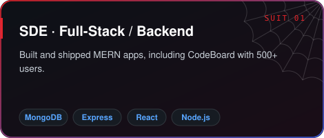
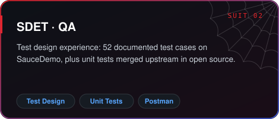
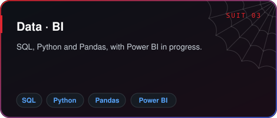
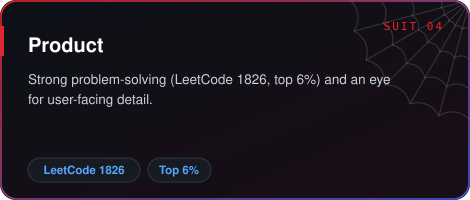
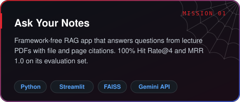
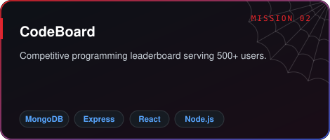
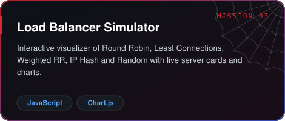
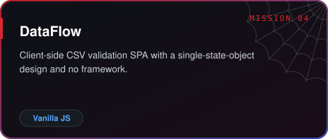
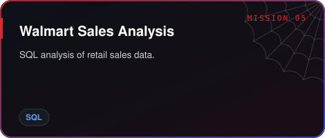

 

I'm a final-year Information Technology student who got bitten by the radioactive bug of full-stack development and hard algorithmic problems. I interned at **DRDO**, where I worked on a Host-Based Intrusion Detection System using OSSEC, and I'm open to **SDE, SDET, Data/BI and Product** roles.

| 🕸️ | Character Sheet |
|:--|:--|
| 🎓 **Education** | B.Tech, Information Technology: BPIT, GGSIPU (2027) |
| 🛡️ **Experience** | Software Development Intern, DRDO (Jun–Jul 2025) |
| 🧠 **Competitive Programming** | LeetCode 1826 · Top 6% globally · 500+ problems |
| 🎯 **Focus** | MERN stack · RAG applications · System design · SQL & BI |
| 🏙️ **Home Turf** | Delhi NCR, India |

 

> **I'm actively looking for internship and placement opportunities** in software development, testing, data and product. If your team needs someone who ships, learns fast and cares about quality, I'd love to talk.

 

**Quick facts:** B.Tech IT, BPIT (GGSIPU), graduating 2027 · Prior internship at DRDO · Based in Delhi NCR, open to remote and on-site.

  

  

  

  

  

**GirlScript Summer of Code**

<table>
  <tr>
    <td align="center" width="150"><b>506th</b> Rank of 17,000+</td>
    <td align="center" width="150"><b>20</b> PRs merged</td>
    <td align="center" width="150"><b>820</b> Total score</td>
    <td align="center" width="150"><b>6</b> Badges</td>
  </tr>
</table>

 

Explorer · Adventurer · Champion · Trailblazer · Summit Seeker · Postman API Student Expert

  

  

  

<picture>
  <source media="(prefers-color-scheme: dark)" srcset="https://raw.githubusercontent.com/Amankr200/Amankr200/output/github-snake-dark.svg" />
  <source media="(prefers-color-scheme: light)" srcset="https://raw.githubusercontent.com/Amankr200/Amankr200/output/github-snake.svg" />
  
</picture>

  

  

I'm open to internships and placements. Email me at **kraman102003@gmail.com**, message me on [LinkedIn](https://www.linkedin.com/in/aman-kumar-india/), or have a look at my [portfolio](https://portfolio-new-aman.vercel.app). Shoot a web my way and I'll swing right back. 🕸️

Built with caffeine, curiosity and a lot of web-fluid (commits).

